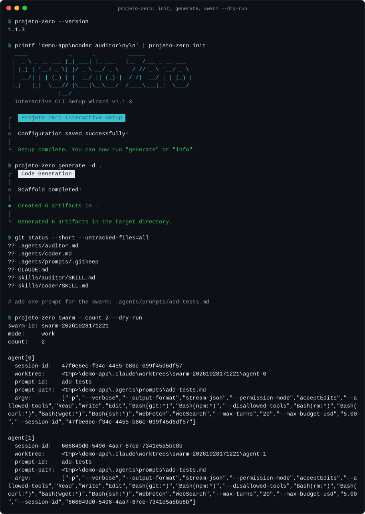
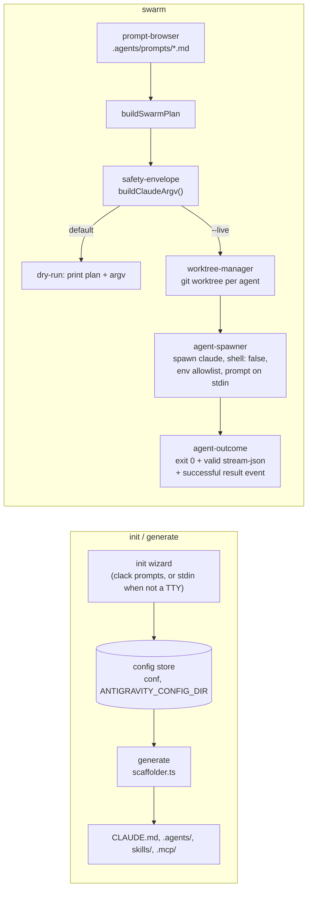

# projeto-zero

[](https://github.com/devkauania/projeto-zero/actions/workflows/ci.yml)
[](https://www.npmjs.com/package/@projeto-zero/cli)
[](apps/cli/package.json)
[](LICENSE)

**A TypeScript CLI that scaffolds [Claude Code](https://docs.claude.com/claude-code) agent workspaces and runs several Claude Code agents in parallel, each in its own git worktree, behind safety defaults you can read in one file.**

Published on npm as [`@projeto-zero/cli`](https://www.npmjs.com/package/@projeto-zero/cli).



<sub>Recorded from this repo's build with `npm run demo` ([`scripts/record-demo.mjs`](scripts/record-demo.mjs)): all program output is real and unedited except that trailing blank lines are trimmed and the temp directory is shortened to `<tmp>` (recorded on Windows, hence the backslashes); the script adds only the `$` command lines and the `#` note. Plain-text copy: [`docs/demo.txt`](docs/demo.txt).</sub>

## Why

Two chores come up as soon as you use Claude Code on more than one task:

1. **Setting up the workspace.** `CLAUDE.md`, subagent files and skills all
   have a frontmatter shape Claude Code expects. Writing them by hand for
   every project is repetitive and easy to get subtly wrong.
2. **Running agents in parallel.** Starting several `claude -p` processes
   from a script is a one-liner, and so are its failure modes: a shell
   string that interpolates a prompt, every parent env var (npm and GitHub
   tokens included) leaking into each child, agents overwriting each other
   in one working directory, `bypassPermissions` turned on by a typo, and a
   run that "succeeds" because nobody checked the exit status.

projeto-zero handles both: a wizard plus generator for the first, and a
`swarm` command for the second whose defaults are conservative and covered
by tests.

## Install

Requires Node.js 20 or newer. [Claude Code](https://docs.claude.com/claude-code)
(`claude` on `PATH`) is needed only for `swarm --live`.

```bash
npx @projeto-zero/cli init          # run without installing
npm install -g @projeto-zero/cli    # or install the `projeto-zero` command
```

## Quickstart

```bash
mkdir demo-app && cd demo-app && git init
npx @projeto-zero/cli init           # wizard: project name, subagents, MCP connectors, templates
npx @projeto-zero/cli generate -d .  # write the scaffold into the current directory
```

`init` is interactive in a terminal. In scripts and CI it reads the three
answers (name, subagents, templates) from stdin instead:

```bash
printf 'demo-app\ncoder auditor\ny\n' | npx @projeto-zero/cli init
```

Output of `generate` for that selection, from `@projeto-zero/cli@1.1.3` on npm:

```text
┌   Code Generation
│
◇  Scaffold completed!
│
◆  Created 6 artifacts in .
│
└  Generated 6 artifacts in the target directory.
```

```text
CLAUDE.md
.agents/coder.md
.agents/auditor.md
.agents/prompts/.gitkeep
skills/coder/SKILL.md
skills/auditor/SKILL.md
```

Each subagent file carries the frontmatter Claude Code reads:

```markdown
---
name: coder
description: Backend implementation subagent — Node.js / TypeScript modules, command wiring, filesystem operations
tools: Read, Write, Edit, Bash, Grep, Glob
---
```

Then put prompt files in `.agents/prompts/` and preview a swarm. Dry-run is
the default; nothing is spawned until you pass `--live`:

```bash
npx @projeto-zero/cli swarm --count 2          # print the plan only
npx @projeto-zero/cli swarm --count 2 --live   # create worktrees and spawn claude
```

> [!IMPORTANT]
> **`swarm --live` in 1.1.3 (the version on npm today) does not work.** Its
> argv includes `--temperature`, `--working-dir` and `--prompt-file`, which
> Claude Code does not have (Claude Code 2.1.310 answers
> `error: unknown option '--temperature'` and exits 1). That fix, plus real
> tool-rule names, a false-success fix and a `generate` path-escape fix, is
> on `main` but not released yet; see [`CHANGELOG.md`](CHANGELOG.md#unreleased).
> Until the next release, run `swarm --live` from a source checkout (see
> [Development](#development)). `init`, `generate`, `info` and `swarm`
> dry-runs work in 1.1.3.

## Commands

| Command | What it does |
|---|---|
| `init` | Wizard that saves a project config: name, subagents (`coder`, `designer`, `auditor`, `mcp`), MCP connectors, whether to include templates. Writes no project files. |
| `generate [-d <dir>]` | Writes `CLAUDE.md`, `.agents/<id>.md`, `.agents/prompts/.gitkeep`, `skills/<id>/SKILL.md` and one `.mcp/<connector>.json` per selected connector. |
| `info` | Prints the saved config. |
| `reset` | Clears the saved config after a confirmation prompt (needs an interactive terminal). |
| `swarm` | Plans, and with `--live` runs, up to 15 Claude Code agents over the prompts in `.agents/prompts/*.md`. Options and defaults: [`docs/SWARM.md`](docs/SWARM.md). |

Full user guide: [`apps/cli/README.md`](apps/cli/README.md) (also the npm
package page).

### Where the generated files go

`generate` writes its own layout. Claude Code discovers project files in
slightly different places, so for now you copy them over:

| Written by `generate` | Where Claude Code looks |
|---|---|
| `CLAUDE.md` | `CLAUDE.md` (same) |
| `.agents/<id>.md` | `.claude/agents/<id>.md` |
| `skills/<id>/SKILL.md` | `.claude/skills/<id>/SKILL.md` |
| `.mcp/<connector>.json` (`id`, `label`, `description`, `tools`) | root `.mcp.json` with `{"mcpServers": {...}}` |

The `.mcp/*.json` files record which connectors you picked but contain no
launch command or URL, so they cannot become `.mcp.json` entries on their
own. Register servers with `claude mcp add --scope project`.

## How it works



- **One place builds the command line.** Every spawn goes through
  `buildClaudeArgv()` in
  [`safety-envelope.ts`](apps/cli/src/lib/swarm/safety-envelope.ts). It
  emits only flags from a recorded list of real Claude Code flags (a
  contract test checks this) and only emits `bypassPermissions` when both
  `--permission-mode bypassPermissions` and `--i-understand` are given.
  Otherwise work mode uses `acceptEdits` and verify mode `plan`.
- **The prompt never touches argv or a shell.** The child is spawned with an
  argv array and `shell: false`; the prompt file is streamed to stdin.
- **Children get a minimal environment.** An allowlist of 11 variables
  (`PATH`, `HOME`, `CLAUDE_CODE_OAUTH_TOKEN`, ...); `NPM_TOKEN`,
  `GITHUB_TOKEN`, `ANTHROPIC_API_KEY` and everything else are dropped.
- **Agents do not share a directory.** Each one starts in
  `.claude/worktrees/<swarm-id>/agent-<n>`, and worktree names are checked
  against a strict pattern.
- **Success is checked, not assumed.** An agent counts as successful only if
  it exits 0, its stdout is valid stream-json and it ends with a successful
  `result` event. Otherwise the run prints why and exits 1.

A guided tour with the code inline is in
[`docs/ARCHITECTURE.md`](docs/ARCHITECTURE.md).

## Security notes

- **Tool rules are a speed bump, not a sandbox.** The default allow/deny
  lists use real Claude Code permission rules (`Read`, `Bash(git:*)`,
  `Bash(rm:*)`, `WebFetch`, ...), but a deny rule matches command text, not
  intent. For hard filesystem or network limits use Claude Code's sandbox or
  a container. Details: [`docs/SWARM.md`](docs/SWARM.md#tool-rules-are-not-a-sandbox).
- **Spend and turn limits** are passed to each `claude` process
  (`--max-budget-usd`, default `5.00`; `--max-turns`, default `20`); the
  launcher itself does not meter spend. On `main`, invalid values are
  refused instead of silently replaced by the defaults.
- **Config store.** `ANTIGRAVITY_CONFIG_DIR` must be under your home or temp
  directory and cannot be a symlink. On POSIX the file is `chmod 0600`.
- **Releases** are built by [`release.yml`](.github/workflows/release.yml)
  on `v*.*.*` tags: actions pinned to commit SHAs, minimal permissions, a
  production `npm audit` gate, preflight, a tag/version check, build and
  test without credentials, then `npm publish --provenance --ignore-scripts`.
  The 1.1.3 package on npm carries a SLSA provenance attestation. Publishing
  still authenticates with an npm token until npm Trusted Publishing is
  configured ([`docs/RELEASING.md`](docs/RELEASING.md)).
- **Findings are tracked in the open.** Every finding and its status, open
  ones included, is in [`audit/vulnerability-ledger.md`](audit/vulnerability-ledger.md).

To report a vulnerability, see [`SECURITY.md`](SECURITY.md).

## Development

```bash
git clone https://github.com/devkauania/projeto-zero.git
cd projeto-zero
npm ci
node scripts/preflight.mjs              # build, type-check, tests, static gates
node apps/cli/dist/index.js --help      # run the CLI from the checkout
```

`preflight` is the same gate CI runs on Ubuntu and Windows. It runs the
build, `tsc --noEmit`, the Vitest suite and 8 static checks (package
manifest and tarball contents, package metadata, leftover-token scan,
self-dependency guard, non-TTY connector default, Claude-only wording guard,
workflow hardening) and prints `preflight: ALL PASS` only when every one
passes. `node scripts/verdict.mjs` turns that result into a single
`PRODUCTION-READY` / `NOT-READY` line.

| Path | What it is |
|---|---|
| `apps/cli/` | The published package (`@projeto-zero/cli`) and its tests. |
| `scripts/` | Preflight gates and the demo recorder. |
| `docs/` | Architecture walkthrough, swarm defaults, releasing, migration notes. |
| `audit/` | Vulnerability ledger, patch write-ups, dated recon reports. |
| `.agents/` | Agent definitions and prompts used by the CLI, plus the build history of this project (session handoffs and validations from building it with AI coding agents), kept as an audit trail. |

## Known limitations

- `generate` writes `.agents/` and `skills/`, not `.claude/agents/` and
  `.claude/skills/` (see [the table above](#where-the-generated-files-go)).
- `swarm --live` streams each agent's output with an `[agent-N]` prefix;
  there is no grid UI yet.
- The command's help text and second binary still use the project's
  original name, `antigravity`, as does the `ANTIGRAVITY_CONFIG_DIR`
  variable. Renaming them is a breaking change saved for a major release.

## Contributing

Issues and pull requests are welcome. Start with
[`CONTRIBUTING.md`](CONTRIBUTING.md); everyone taking part follows the
[Code of Conduct](CODE_OF_CONDUCT.md).

## License

[MIT](LICENSE)
